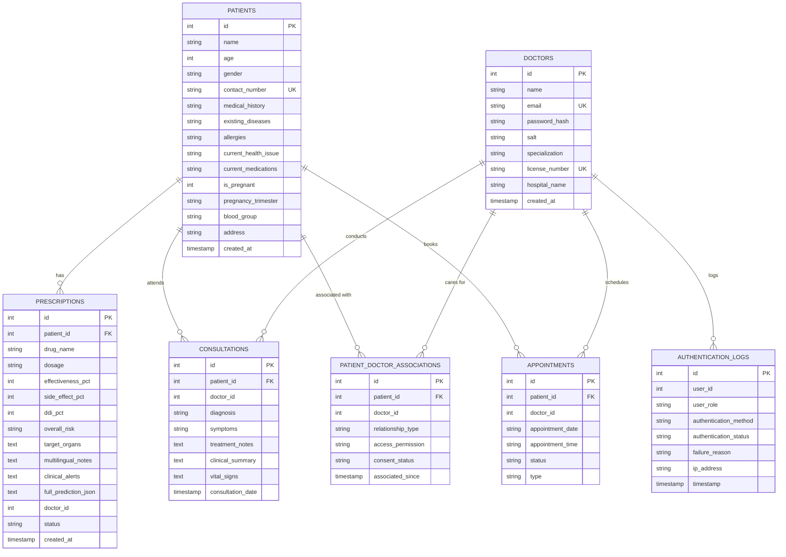

# DrugAI SQL Relational Database Architecture

**Comprehensive Guide to Data Persistence, Relational Schemas, and SQL Operations**

---

## 1. Overview of SQL Engine

The DrugAI decision-support system uses an **ACID-compliant Relational SQL Database Architecture** powered by SQLite (`sqlite3`), storing structured patient records, multi-doctor associations, prescriptions, consultations, appointments, and security audit trails across two dedicated databases:

1. **`drug_ai.db`**: Primary clinical health database (patients, prescriptions, medical history, consultations, appointments).
2. **`users.db`**: Authentication and security audit database (doctor credentials, PBKDF2 hashes, multi-factor authenticator secrets, security audit logs).

### Why SQLite for DrugAI?
- **Standard SQL Relational Model**: Standard SQL queries (`SELECT`, `JOIN`, `INSERT`, `UPDATE`, `DELETE`, `GROUP BY`, `FOREIGN KEY`).
- **ACID Compliance**: Full Atomicity, Consistency, Isolation, and Durability guarantees.
- **Zero External Server Overhead**: Runs natively inside the Python runtime environment without requiring separate network daemon configuration, making local clinical setups instantly reliable.
- **Enabled Foreign Keys & Indexes**: Enforces relational data integrity (`PRAGMA foreign_keys = ON;`) with B-tree indexes for millisecond query performance.

---

## 2. Entity-Relationship (ER) Diagram



---

## 3. SQL Tables & Schema Specifications

### Database 1: `drug_ai.db`

#### 1. `patients` Table
Stores patient demographic baselines and medical background:
```sql
CREATE TABLE patients (
    id INTEGER PRIMARY KEY AUTOINCREMENT,
    name TEXT NOT NULL,
    age INTEGER NOT NULL,
    gender TEXT NOT NULL,
    contact_number TEXT UNIQUE NOT NULL,
    medical_history TEXT,
    existing_diseases TEXT,
    allergies TEXT,
    current_health_issue TEXT,
    current_medications TEXT,
    is_pregnant INTEGER DEFAULT 0,
    pregnancy_trimester TEXT,
    blood_group TEXT DEFAULT 'O+',
    emergency_contact TEXT DEFAULT '',
    address TEXT DEFAULT '',
    created_at TIMESTAMP DEFAULT CURRENT_TIMESTAMP
);
CREATE INDEX idx_patients_contact ON patients(contact_number);
```

#### 2. `prescriptions` Table
Stores issued prescriptions alongside full prediction snapshot and ongoing status:
```sql
CREATE TABLE prescriptions (
    id INTEGER PRIMARY KEY AUTOINCREMENT,
    patient_id INTEGER NOT NULL,
    patient_name TEXT,
    patient_contact TEXT,
    drug_name TEXT NOT NULL,
    dosage TEXT,
    effectiveness_pct INTEGER,
    side_effect_pct INTEGER,
    ddi_pct INTEGER,
    overall_risk TEXT,
    target_organs TEXT,
    multilingual_notes TEXT,
    clinical_alerts TEXT,
    doctor_notes TEXT,
    xai_factors TEXT,
    dietary_warnings TEXT,
    full_prediction_json TEXT,
    doctor_id INTEGER DEFAULT 1,
    doctor_name TEXT DEFAULT 'Dr. Sharma, MD',
    doctor_specialization TEXT DEFAULT 'Cardiology & Internal Medicine',
    doctor_hospital TEXT DEFAULT 'Apex Multispecialty Hospital',
    frequency TEXT DEFAULT 'Once daily',
    start_date TEXT DEFAULT '',
    end_date TEXT DEFAULT '',
    instructions TEXT DEFAULT 'Take with water after meals',
    status TEXT DEFAULT 'active',               -- 'active' | 'completed' | 'discontinued'
    discontinued_reason TEXT DEFAULT '',
    status_updated_at TIMESTAMP DEFAULT CURRENT_TIMESTAMP,
    created_at TIMESTAMP DEFAULT CURRENT_TIMESTAMP,
    FOREIGN KEY (patient_id) REFERENCES patients (id)
);
CREATE INDEX idx_prescriptions_patient ON prescriptions(patient_id);
CREATE INDEX idx_prescriptions_status ON prescriptions(status);
```

#### 3. `consultations` Table
Tracks patient-doctor clinical visits, diagnoses, and vital signs:
```sql
CREATE TABLE consultations (
    id INTEGER PRIMARY KEY AUTOINCREMENT,
    patient_id INTEGER NOT NULL,
    doctor_id INTEGER NOT NULL,
    doctor_name TEXT NOT NULL,
    doctor_specialization TEXT,
    hospital_name TEXT,
    consultation_date TIMESTAMP DEFAULT CURRENT_TIMESTAMP,
    diagnosis TEXT NOT NULL,
    symptoms TEXT,
    treatment_notes TEXT,
    clinical_summary TEXT,
    vital_signs TEXT,
    medical_reports TEXT,
    prescription_ids TEXT,
    follow_up_date TEXT,
    created_at TIMESTAMP DEFAULT CURRENT_TIMESTAMP,
    FOREIGN KEY (patient_id) REFERENCES patients (id)
);
CREATE INDEX idx_consultations_patient ON consultations(patient_id);
```

#### 4. `patient_doctor_associations` Table
Manages multi-doctor care teams and patient consent access levels:
```sql
CREATE TABLE patient_doctor_associations (
    id INTEGER PRIMARY KEY AUTOINCREMENT,
    patient_id INTEGER NOT NULL,
    doctor_id INTEGER NOT NULL,
    doctor_name TEXT NOT NULL,
    doctor_specialization TEXT,
    doctor_hospital TEXT,
    relationship_type TEXT DEFAULT 'treating',  -- 'treating' | 'consulting' | 'referral'
    access_permission TEXT DEFAULT 'full',      -- 'full' | 'prescribe_only' | 'view_only'
    consent_status TEXT DEFAULT 'granted',     -- 'granted' | 'revoked' | 'pending'
    notes TEXT,
    associated_since TIMESTAMP DEFAULT CURRENT_TIMESTAMP,
    last_interaction TIMESTAMP DEFAULT CURRENT_TIMESTAMP,
    FOREIGN KEY (patient_id) REFERENCES patients (id),
    UNIQUE(patient_id, doctor_id)
);
CREATE INDEX idx_patient_doc_assoc ON patient_doctor_associations(patient_id, doctor_id);
```

#### 5. `appointments` Table
Manages upcoming and past clinical consultations:
```sql
CREATE TABLE appointments (
    id INTEGER PRIMARY KEY AUTOINCREMENT,
    patient_id INTEGER NOT NULL,
    patient_name TEXT NOT NULL,
    patient_contact TEXT,
    doctor_id INTEGER NOT NULL,
    doctor_name TEXT NOT NULL,
    doctor_specialization TEXT,
    appointment_date TEXT NOT NULL,
    appointment_time TEXT NOT NULL,
    reason TEXT,
    status TEXT DEFAULT 'confirmed',           -- 'confirmed' | 'completed' | 'cancelled'
    type TEXT DEFAULT 'In-Person Consultation',
    created_at TIMESTAMP DEFAULT CURRENT_TIMESTAMP,
    FOREIGN KEY (patient_id) REFERENCES patients (id)
);
CREATE INDEX idx_appointments_patient ON appointments(patient_id);
CREATE INDEX idx_appointments_doctor ON appointments(doctor_id);
```

---

### Database 2: `users.db`

#### 1. `doctors` Table
Stores registered physician credentials, hashed passwords, and hospital affiliations:
```sql
CREATE TABLE doctors (
    id INTEGER PRIMARY KEY AUTOINCREMENT,
    name TEXT NOT NULL,
    email TEXT UNIQUE NOT NULL,
    password_hash TEXT NOT NULL,
    salt TEXT NOT NULL,
    specialization TEXT NOT NULL,
    license_number TEXT UNIQUE NOT NULL,
    hospital_name TEXT NOT NULL,
    phone_number TEXT,
    is_active INTEGER DEFAULT 1,
    created_at TIMESTAMP DEFAULT CURRENT_TIMESTAMP,
    last_login TIMESTAMP
);
CREATE INDEX idx_doctors_email ON doctors(email);
CREATE INDEX idx_doctors_license ON doctors(license_number);
```

#### 2. `authentication_logs` Table
Comprehensive security audit trail for compliance (HIPAA / DISHA):
```sql
CREATE TABLE authentication_logs (
    id INTEGER PRIMARY KEY AUTOINCREMENT,
    user_id INTEGER,
    user_role TEXT NOT NULL,
    authentication_method TEXT NOT NULL,
    authentication_status TEXT NOT NULL,       -- 'SUCCESS' | 'FAILED' | 'REVOKED'
    failure_reason TEXT,
    device_information TEXT DEFAULT 'Clinical Console',
    ip_address TEXT DEFAULT '127.0.0.1',
    timestamp TIMESTAMP DEFAULT CURRENT_TIMESTAMP
);
CREATE INDEX idx_auth_logs_user ON authentication_logs(user_id, timestamp);
```

---

## 4. Pipeline Integration with SQL

Every stage of the backend pipeline reads or writes to the SQL tables:

1. **Stage 1 (Ingestion)**:
   ```sql
   SELECT * FROM patients WHERE contact_number = :contact_number;
   ```
2. **Stage 2 & 3 (Screening & Prediction)**:
   Loads patient allergies, conditions, and concurrent medications directly from the `patients` record.
3. **Stage 4 (Prescribe & Store)**:
   ```sql
   INSERT INTO prescriptions (
       patient_id, patient_name, drug_name, dosage,
       effectiveness_pct, side_effect_pct, ddi_pct, overall_risk,
       target_organs, multilingual_notes, full_prediction_json, status
   ) VALUES (?, ?, ?, ?, ?, ?, ?, ?, ?, ?, ?, 'active');
   ```
4. **Stage 5 (Timeline & History)**:
   ```sql
   SELECT p.*, pt.age, pt.gender, pt.allergies
   FROM prescriptions p
   JOIN patients pt ON p.patient_id = pt.id
   WHERE p.patient_id = ?
   ORDER BY p.id DESC;
   ```

---

## 5. Future PostgreSQL / MySQL Migration Path

Since the table schemas follow standard ANSI SQL conventions, migrating to an external server (such as PostgreSQL or MySQL) requires only updating the connection factory in `backend/database.py` and `backend/auth_db.py`:

```python
# For PostgreSQL (permission granted):
import psycopg2
from psycopg2.extras import RealDictCursor

def get_db_connection():
    return psycopg2.connect(
        host=os.environ.get("DB_HOST", "localhost"),
        database=os.environ.get("DB_NAME", "drugai"),
        user=os.environ.get("DB_USER", "postgres"),
        password=os.environ.get("DB_PASS", "postgres"),
        cursor_factory=RealDictCursor
    )
```
For local execution, the included SQLite implementation provides identical SQL behavior with zero latency and zero external dependencies.
